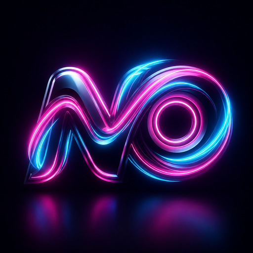
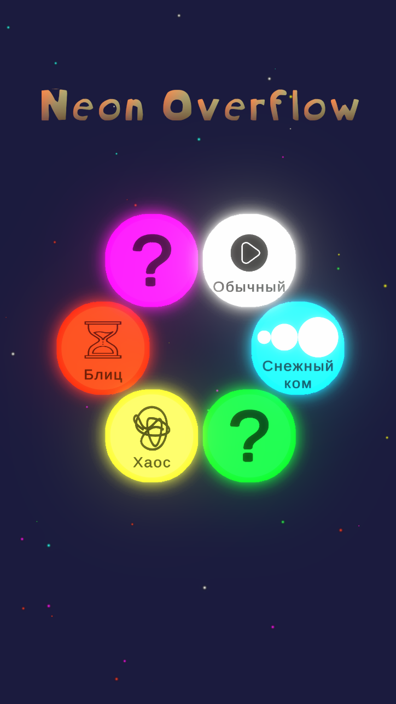
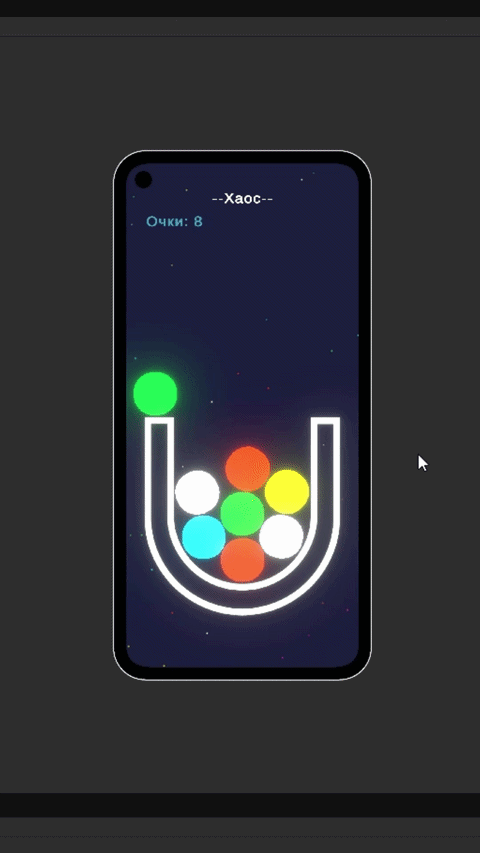

# Neon Overflow 🌌

Neon Overflow — это минималистичная физическая головоломка, где твоя цель — управлять падением неоновых шариков и не дать им переполнить контейнер. Простой геймплей, залипательная физика и эстетика киберпанка.

---

## 🎮 Геймплей

Цель игры проста: сбрасывай разноцветные шарики в U-образную корзину. Но будь осторожен — если шарики начнут выходить за пределы контейнера, игра закончится!

### Режимы игры:

| Режим | Описание |
| :--- | :--- |
| **Обычный** | Классический геймплей без ограничений. |
| **Блиц** | Игра на время. Успей набрать очки быстрее! |
| **Снежный ком** | Шарики увеличиваются в размерах при падении. |
| **Хаос** | Непредсказуемая физика и случайные эффекты. |

---

## 📸 Скриншоты

---

## 🚀 Как поиграть?

Игра доступна для скачивания в **RuStore**:
👉 [Скачать Neon Overflow в RuStore](https://www.rustore.ru/catalog/app/com.kgz.senior.NeonOverflow)

---

## 🛠 Технологии

Игра разработана с использованием:
* **Движок:** [Например: Unity]
* **Язык:** [Например: C#]
* **Графика:** Неоновый арт, векторная графика.

---

## 🤝 Контрибьюторам

Проект открыт для предложений! Если у тебя есть идеи по новым режимам или ты нашел баг — создавай [Issue](https://github.com/toctosunov/Neon-Overflow) или присылай Pull Request.

---

## 📜 Лицензия

Этот проект распространяется под лицензией MIT. Подробности смотри в файле [LICENSE](LICENSE).
